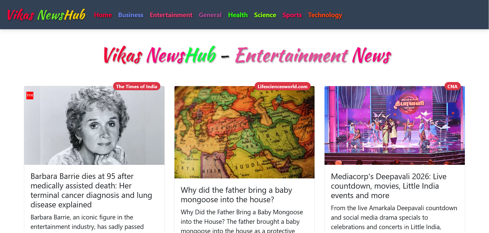

# 📰 Vikas News Hub

A responsive News Application built using React.js, JavaScript, Bootstrap, and React Router.

This project displays news articles across different categories with a clean and user-friendly interface.

## 🌐 Live Demo

🔗 https://vikasp-sw.github.io/react-news-app/

> **Note:** The application works on localhost. Live news articles may not load on GitHub Pages due to NewsAPI's free Developer plan restrictions.

## 📸 Project Screenshots

### Screenshot 1

### Screenshot 2

## ✨ Features

- Responsive news application
- Category-based news navigation
- General, Business, Entertainment, Health, Science, Sports, and Technology categories
- News cards with images and descriptions
- News source badges
- Previous and Next pagination
- Loading spinner
- React Router navigation
- Bootstrap-based responsive design

## 🛠️ Technologies Used

- React.js
- JavaScript (ES6+)
- HTML5
- CSS3
- Bootstrap
- React Router
- NewsAPI
- Git & GitHub

## 💻 Run Locally

1. Clone the repository:

   git clone https://github.com/VikasP-SW/react-news-app.git

2. Open the project folder:

   cd react-news-app

3. Install dependencies:

   npm install

4. Create a `.env` file in the project root and add:

   REACT_APP_NEWS_API=YOUR_API_KEY

5. Start the application:

   npm start

## 📌 Project Status

✅ React application completed  
✅ Responsive UI implemented  
✅ GitHub repository published  
✅ GitHub Pages deployment completed  
⚠️ Live news fetching is limited by NewsAPI production restrictions.

## 👨‍💻 Developer

**Vikas Pawar**

Frontend Developer | React.js Developer

⭐ If you like this project, consider giving it a star!
